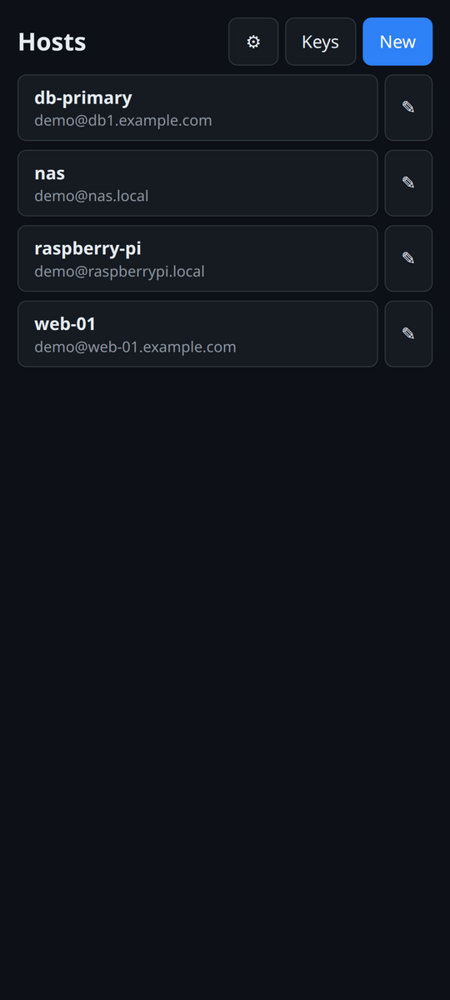
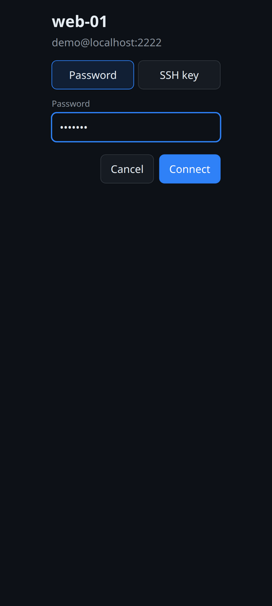
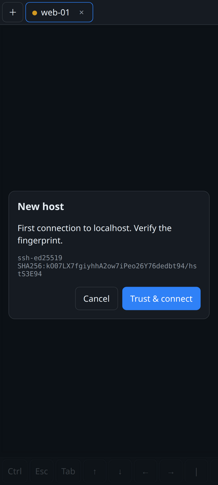
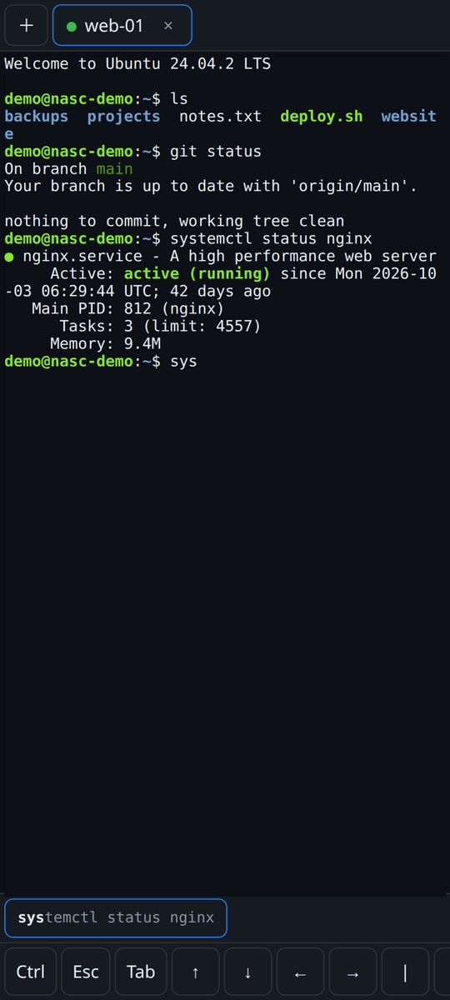
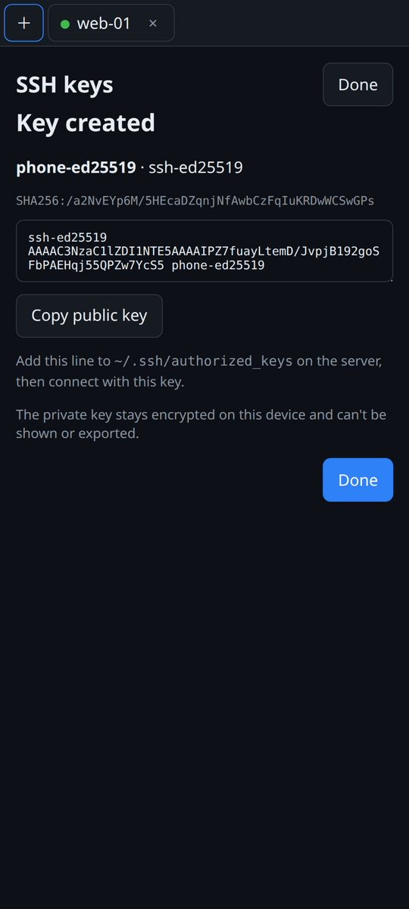

# Nasc

A fast, private SSH client for Android. No account, no ads, no analytics: your hosts and keys never
leave your phone.

## Install

Requires Android 8.0 or newer.

1. Open the [latest release](../../releases/latest) on your phone and download `nasc-<version>.apk`.
2. Open the downloaded file. Android will ask you to allow installs from your browser or file
   manager ("Install unknown apps"); allow it, then tap **Install**. You can turn that permission
   off again afterwards.
3. (Optional) Check the download against `SHA256SUMS` from the same release:
   `sha256sum -c SHA256SUMS` on a computer.

Updates: install the newer APK over the old one. Your hosts and keys are kept, as long as both
APKs came from this project's releases (they share a signing key).

## Using Nasc

**Add a server.** On the Hosts screen tap **New**, then enter a name, address, port and username.

**Connect.** Tap a host and choose **Password** or **SSH key**, then **Connect**. Passwords are
never saved.

**Verify the server.** The first time you connect, Nasc shows the server's key fingerprint. Compare
it with the one on your server (`ssh-keygen -lf /etc/ssh/ssh_host_ed25519_key.pub`) and tap
**Trust & connect**. If the key ever changes, Nasc warns you before connecting.

**Use the terminal.** Tabs along the top keep several sessions open (**＋** goes back to the host
list). The key row at the bottom has Ctrl (sticky), Esc, Tab, arrows and `|`. Sessions stay
connected in the background; a "Nasc is running" notification shows while any are open.

**Autocomplete.** As you type, Nasc suggests commands from your own history on that host. Tap the
suggestion or press Tab to accept it. Anything typed at a password prompt is never recorded.

**Use SSH keys.** Open **Keys**, then **Generate key** (Ed25519 or RSA) or **Import key**. For a
generated key, tap **Copy public key** and append it to `~/.ssh/authorized_keys` on your server.
Private keys are encrypted with the Android Keystore and can't be exported.

**App lock.** In settings (⚙) you can require your fingerprint, face or screen lock to open Nasc.
Saved SSH keys can't be decrypted without it, and it's asked again after the app has been away for
30 seconds. Open sessions keep running in the background.

## Privacy

Nasc has no servers and collects nothing. See [docs/PRIVACY.md](docs/PRIVACY.md).

## Support

Nasc is free and open source. If it's useful to you, you can [chip in via PayPal](https://paypal.me/padraicc). Never expected, always appreciated.

## License

MIT. See [LICENSE](LICENSE). Third-party notices: Go and `golang.org/x/crypto` (BSD-3),
`github.com/coder/websocket` (ISC), Svelte/SvelteKit and xterm.js (MIT), AndroidX (Apache-2.0).

## Build from source

| Layer | Tech | Where |
|---|---|---|
| UI + terminal | SvelteKit (static), xterm.js | `web/` |
| SSH, host store, known-hosts | Go (`x/crypto/ssh`), bound with gomobile | `core/` |
| App shell, foreground service | Kotlin, WebView | `android/` |

The Go core embeds the built web app and serves it, plus a JSON API and one WebSocket per
terminal tab, on `127.0.0.1` with a per-launch token. The WebView loads that URL.
The wire protocol is documented at the top of `core/session.go`.

### Commands

- `make dev` – build the web app and run the core on your desktop; open the printed URL.
- `make test` – Go tests (in-process SSH server) + web type-check and unit tests.
- `make android` – build `android/app/build/outputs/apk/debug/app-debug.apk`
  (needs `ANDROID_HOME` and NDK r28).

### Status

Working: password and private-key auth, Keystore-encrypted key manager (generate/import), app lock,
trust-on-first-use host keys (with changed-key warning), saved hosts, multiple tabs, resize,
keepalive, extra key row, history autocomplete, background foreground service.

Next: SFTP, port forwarding, jump hosts, snippets, themes, reconnect on network change.

### Releasing

- GitHub APK: `./scripts/release-apk.sh` (see [docs/RELEASE.md](docs/RELEASE.md))
- Play Store bundle: `./scripts/release.sh`
