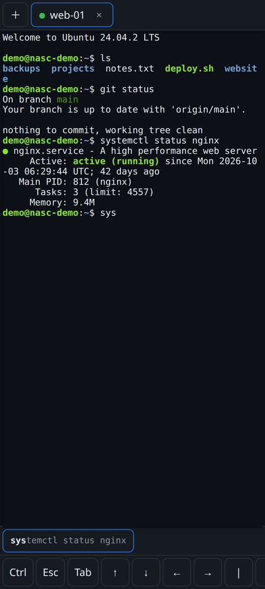
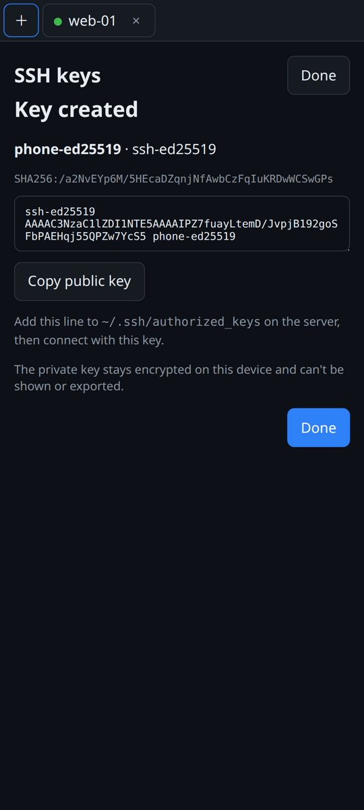

# Nasc

A fast, private SSH client for Android. No account, no ads, no analytics: your hosts and keys never
leave your phone.

[**Download the latest APK**](https://github.com/padraicbc/nasc/releases/latest) ·
[Source on GitHub](https://github.com/padraicbc/nasc) · [Privacy policy](privacy/)

## Features

- Password and SSH-key login, trust-on-first-use host verification with changed-key warnings
- Multiple tabs that stay connected in the background
- Generate or import keys, encrypted with the Android Keystore; optional app lock
- Autocomplete from your own command history, never recording password prompts
- Extra key row: Ctrl, Esc, Tab, arrows, `|`

Install and usage instructions are in the [README](https://github.com/padraicbc/nasc#readme).

## Support

Nasc is free and open source. If it's useful to you, you can [chip in via PayPal](https://paypal.me/padraicc).
